# traccia

Coach panel on the web + athlete app on iOS/Android. Programs, sessions, and analytics.

<p align="center">
  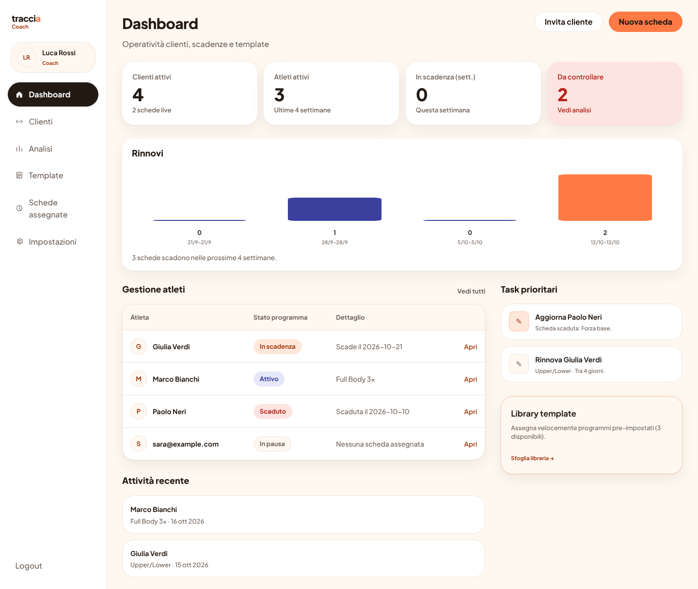
</p>

## Coach (web)

Assign programs, build workouts, follow clients, and check analytics.

<p align="center">
  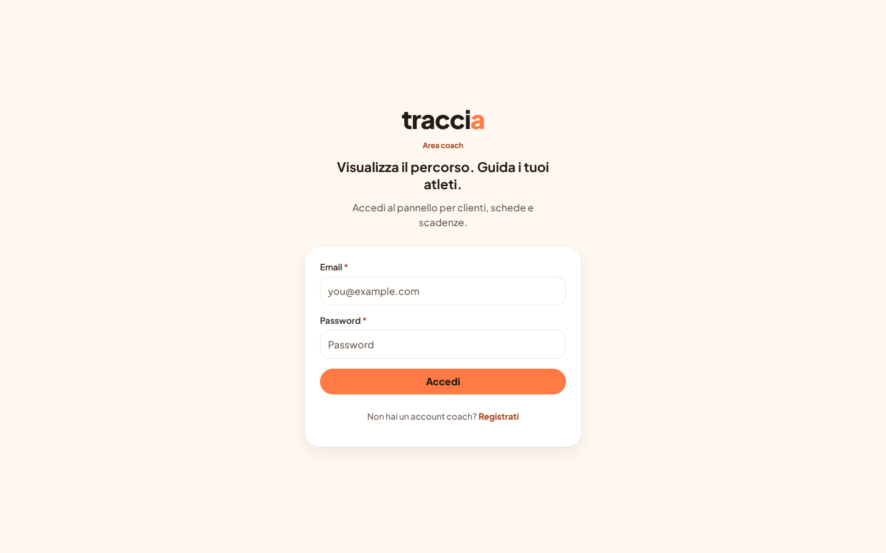
  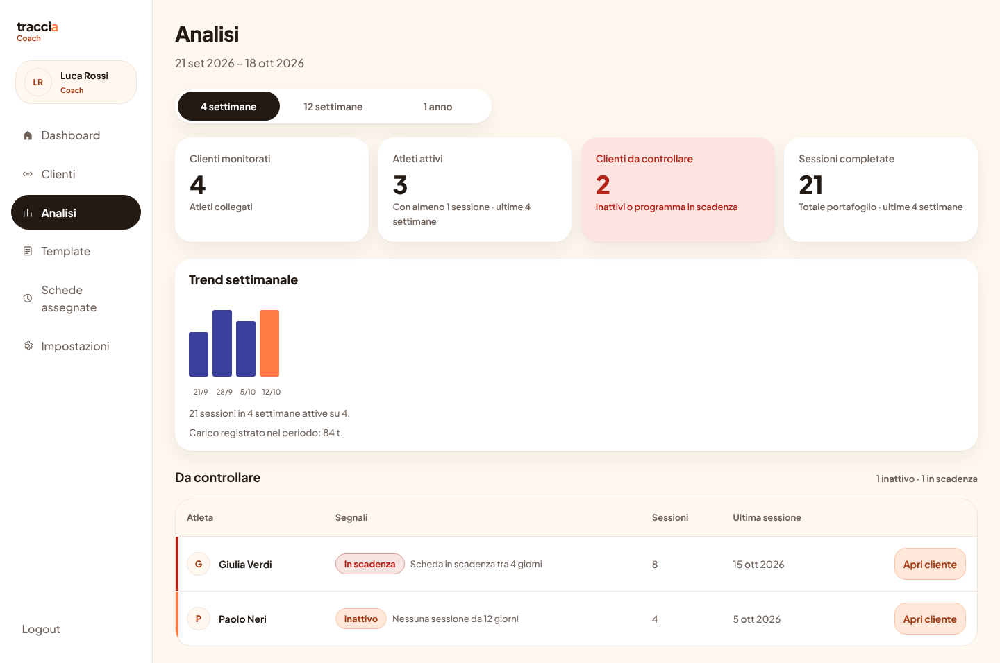
</p>

<p align="center">
  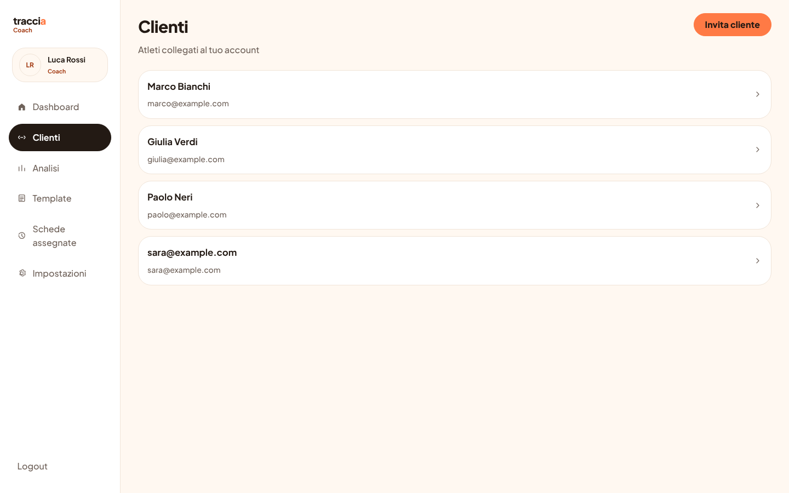
  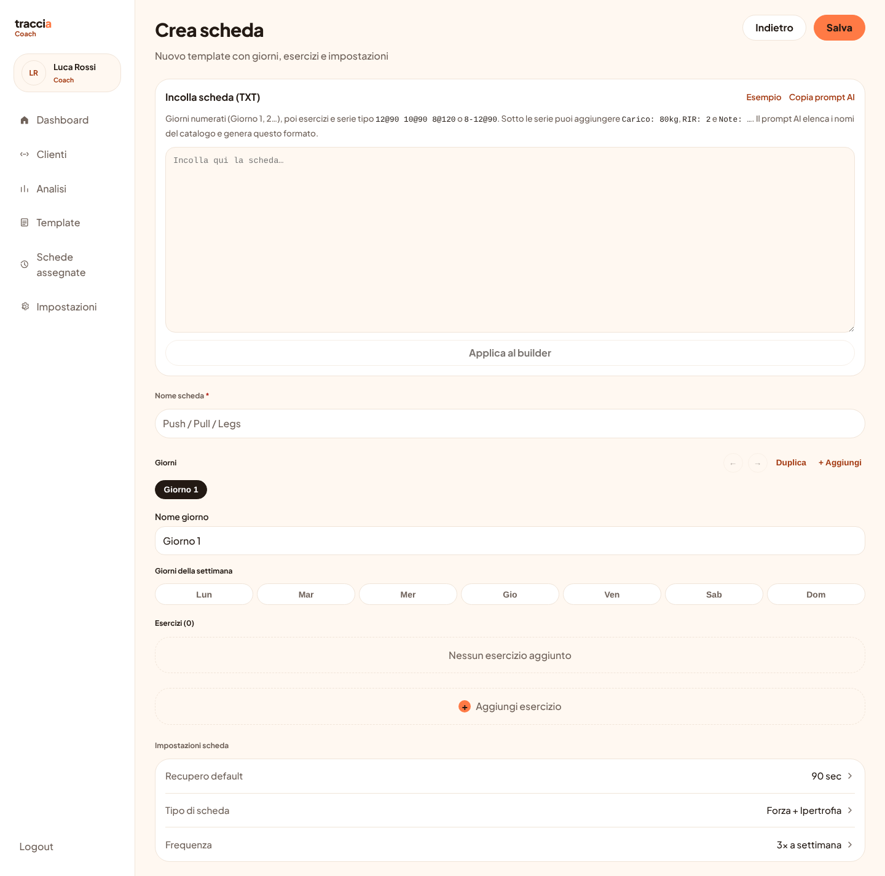
</p>

## Athlete (mobile)

Open today’s program, start the workout, log sets, track progress.

<p align="center">
  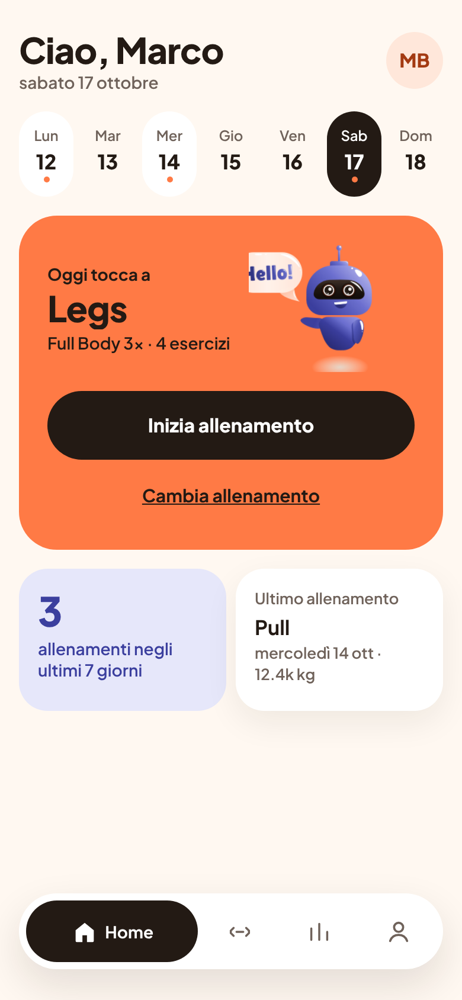
  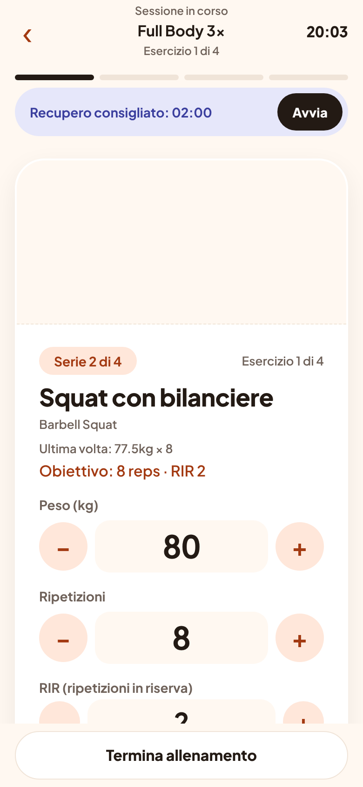
  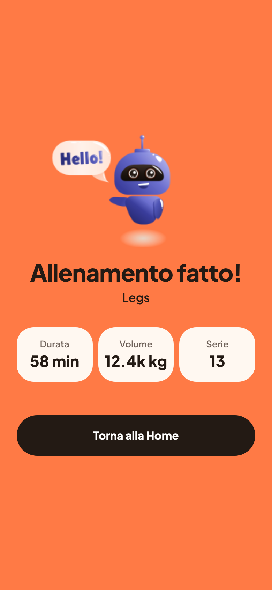
</p>

<p align="center">
  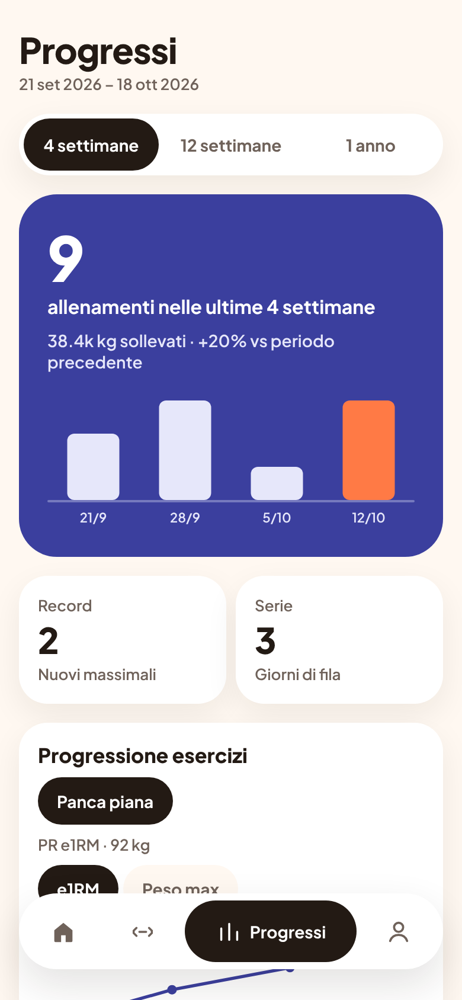
  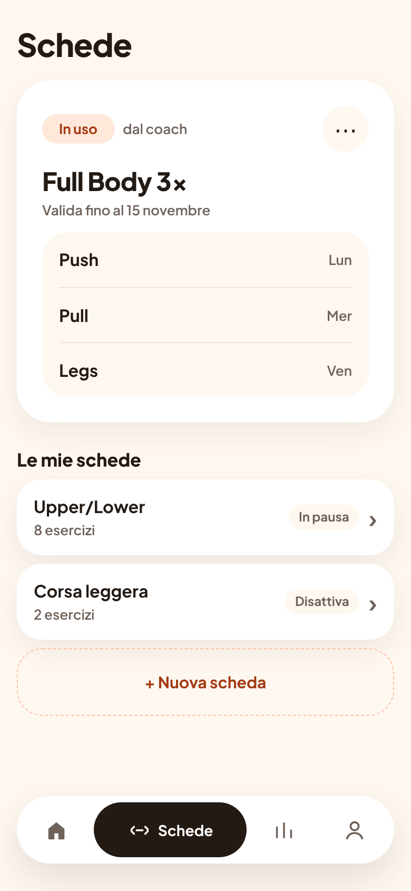
  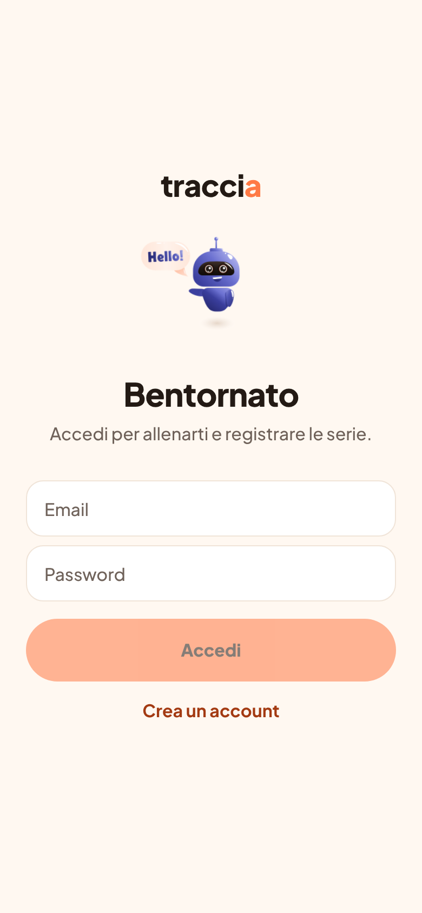
</p>

Screenshots of the "Sole" design (M4), rendered from the Expo web build and the coach panel with sample data.

## Stack

| | |
| --- | --- |
| Web | React + Vite + TypeScript |
| Mobile | Expo + React Native + TypeScript |
| API | Express + Drizzle + Postgres |
| Landing | Astro (static waitlist) |

## Dev

```bash
npm run db:up          # Postgres
cd be && npm run dev   # API :3005
cd fe && npm run dev   # Web :5173
cd mobile && npm start # Expo (i for iOS)
cd landing && npm run dev  # Waitlist :4321
```

## GitHub Pages

One site, two paths. The coach panel stays where it is; the waitlist is a subpath.

- App: https://grillia.github.io/workoutPlanner/
- Landing: https://grillia.github.io/workoutPlanner/landing/

The waitlist form uses the repository variable `PUBLIC_WAITLIST_ENDPOINT` at build time. Until that variable is set, the form shows a demo success state. See [`landing/README.md`](landing/README.md).

See [`AGENTS.md`](AGENTS.md) for details.
